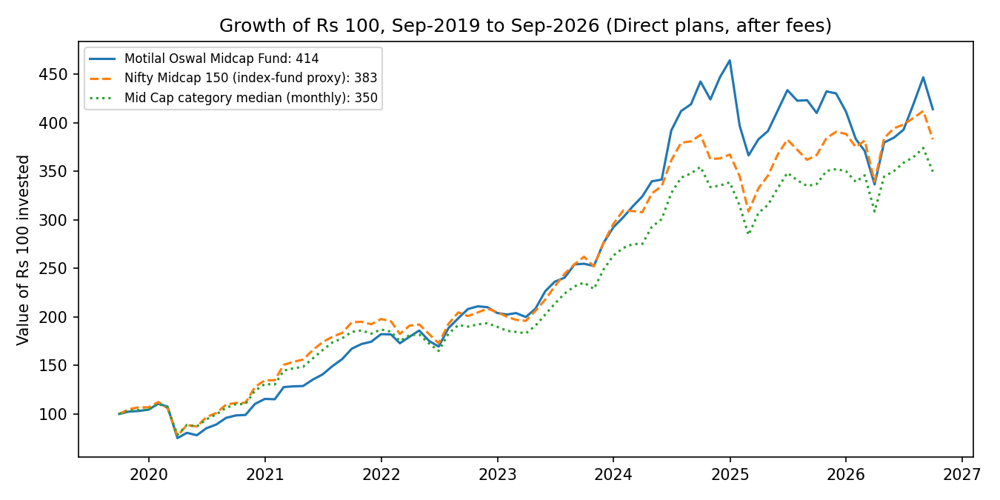
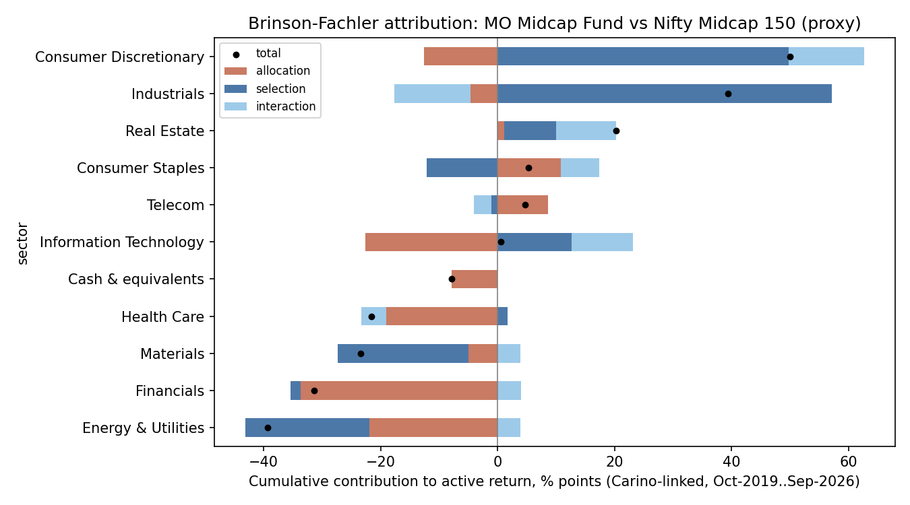
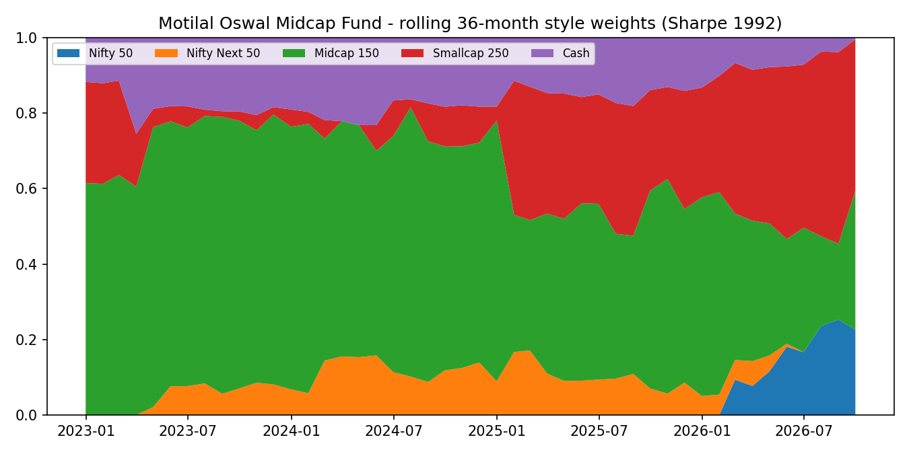
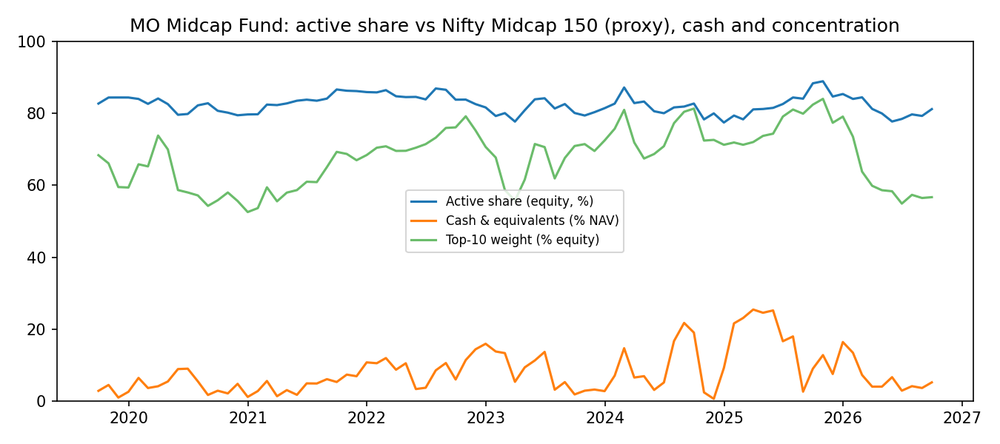
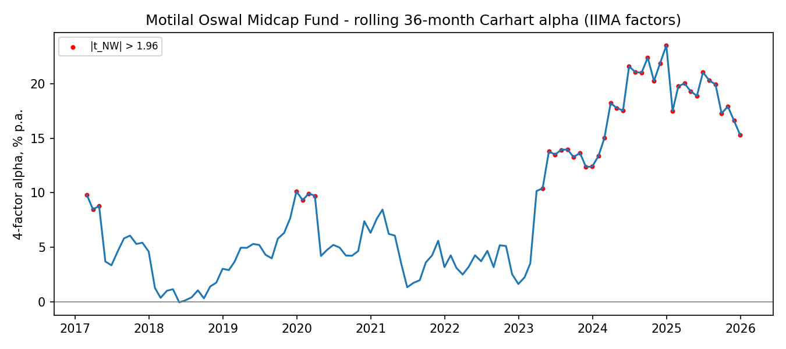

# Skill or style? Performance attribution of Motilal Oswal Midcap Fund

A fully reproducible study of **Motilal Oswal Midcap Fund – Direct Plan Growth** (AMFI code 127042) against its
benchmark, the **Nifty Midcap 150 TRI**. It asks four questions:

1. **Where did the return come from?** Brinson-Fachler sector attribution.
2. **How different is the fund from its index?** Active share.
3. **What does it behave like?** Returns-based style analysis (Sharpe 1992).
4. **Is the alpha skill or luck?** Four-factor alpha with Newey-West SEs, capture ratios, and a bootstrap across the whole AMFI Mid Cap category.

**One command reproduces every table and chart.** You need no API keys; the analysis runs on the committed data snapshot:

```bash
pip install -r requirements.txt
python run_all.py
```

Then open **[`notebooks/P3_walkthrough.ipynb`](notebooks/P3_walkthrough.ipynb)** for a guided tour with charts. The notebook is saved already executed, so GitHub renders it. The full write-up is in [`docs/findings.md`](docs/findings.md).

---

## Key results (snapshot: data to Sep 2026; IIMA factors to Dec 2025)



| | Result |
|---|---|
| **Return, Oct 2019 – Sep 2026** (Direct plans, after fees) | ₹100 → **₹414** for the fund, ₹383 for the Midcap 150 proxy, ₹350 for the category median. **22.5% vs 21.1% a year.** |
| **Capture vs benchmark** | Up **96%**, down **87%**. The fund won by **falling less**, not by rising more. |
| **Brinson attribution** | Stock **selection +71.5 pts**, sector/cash **allocation −106.8 pts**, interaction +31.8 pts (cumulative, Carino-linked). Net holdings-based active return ≈ 0. The rest of the NAV outperformance is a **+1.5% a year "return gap"** from trading between month-ends. |
| **Active share** | **0.82** on average (0.77–0.89). About 26 stocks; top 10 = 68% of equity. |
| **Style (Sharpe)** | Behaves like **62% Midcap 150 + 27% Smallcap 250 + 11% cash**. R² = 0.82. |
| **Four-factor alpha (IIMA)** | **7.7% a year, t = 2.6** (Mar 2014 – Dec 2025). The *passive* Midcap 150 index fund also shows 3.7% a year "alpha" in the same model. |
| **Skill vs luck (bootstrap, 2,000 runs)** | IIMA model: p = 0.02, but **the whole category** looks skilled, which points to a model problem. **Against the passive mid-cap benchmark: alpha 2.6% a year, t = 0.7, p = 0.31. Not distinguishable from luck.** |

<p float="left">
  
  
</p>
<p float="left">
  
  
</p>

---

## Repository layout

```
p3config.py              paths, study constants, HTTP cache + rate limiter, logging
run_all.py               one command: analysis (+ optional --rebuild of the data) + executes the notebook
pipeline/                data build (only needed with --rebuild)
  p01_amfi_nav.py        AMFI daily NAVs: fund, all Mid Cap funds, index-fund TRI proxies
  p02_moamc_portfolios_download.py   MOAMC month-end portfolio files (SEBI disclosure)
  p03_moamc_portfolios_parse.py      holdings of the fund and of the Midcap 150 index fund
  p04_upstox_instruments.py          ISIN master (public Upstox instrument file)
  p05_stock_prices.py    monthly stock returns for every holding (Upstox API, needs a token)
  p06_iima_factors.py    IIMA Indian Fama-French-Momentum factors
  p07_manifest.py        rows / date range / SHA-256 of every input
analysis/                the tests; read only data/processed/, write results/
  a_common.py            shared inputs, sector map, data-derived sample windows
  t1_brinson.py  t2_active_share.py  t3_style.py  t4_alpha_capture.py  t5_skill_luck.py  t6_charts.py
data/processed/          committed snapshot of all analysis inputs (+ MANIFEST.csv)
data/raw/                download cache (git-ignored; recreated by --rebuild)
results/                 every table (.csv) and chart (.png), by test
notebooks/               P3_walkthrough.ipynb (executed) and build_notebook.py (its source)
docs/                    findings.md (write-up), data_sources.md (sources, terms, proxies)
```

## Rebuilding the data from source (optional)

```bash
export UPSTOX_ACCESS_TOKEN=...      # Windows PowerShell: $env:UPSTOX_ACCESS_TOKEN="..."
python run_all.py --rebuild
```

- **Time:** about 1.5–2 hours, because the AMFI and MOAMC servers are slow. All downloads are cached in `data/raw/`, so reruns are fast.
- **Upstox token:** needed only for stock prices. It's a personal token from an Upstox developer app and expires daily.
- **Other sources:** AMFI, MOAMC and IIMA need no keys.
- **Sample windows:** derived from the data (`analysis/a_common.py`), so a rebuild extends every test to the latest complete month.
- **Expected differences:** a rebuild on a later date will differ from the snapshot. NAVs and portfolios extend, IIMA may publish a new release (pinned in `p3config.IIMA_RELEASE`), and the Upstox API can price a few more stocks than the snapshot (e.g. BE-series stocks). Compare against `data/processed/MANIFEST.csv`.
- **How the price snapshot was built:** with `--local-prices`, from Upstox daily closes downloaded earlier from the same endpoint. I spot-checked it against the live API (zero difference).

## Data sources and caveats (details in [`docs/data_sources.md`](docs/data_sources.md))

- **NAVs:** AMFI (personal, non-commercial use). **Portfolios:** MOAMC website (SEBI-mandated monthly disclosure). **Stock prices:** Upstox API. **Factors:** IIMA Indian Fama-French-Momentum library. Cite Agarwalla, Jacob & Varma (2013).
- **Benchmark and style indices are proxies.** I use MOAMC index-fund NAVs, which track the TRI minus ~0.2–0.3% TER, from Sep/Dec 2019, because niftyindices.com doesn't permit automated download. Benchmark weights come from the index fund's holdings.
- **Stock returns exclude dividends.** Attribution is holdings-based at month-end snapshots.
- **Sectors** are a documented roll-up of AMFI industry labels into 10 sectors (`analysis/a_common.py`).
- **The peer bootstrap includes only funds alive today** (survivorship bias). IIMA factors end Dec 2025.
- **Redistribution:** the snapshot in `data/processed/` is derived from third-party sources whose terms may restrict redistribution. Check them before reusing the data. The code is the contribution here.

## Licence
Code: [MIT](LICENSE). The MIT licence covers the code only. Data in `data/processed/` and `results/` is derived from third-party sources and remains subject to their terms (see above).
